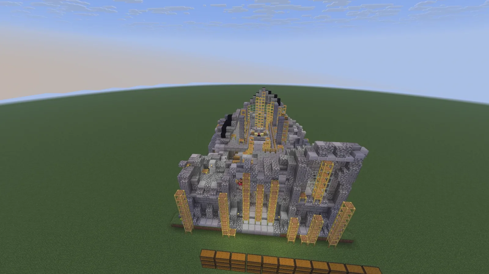
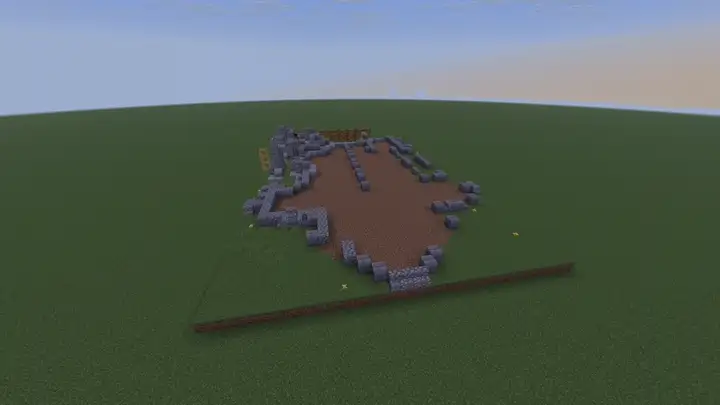
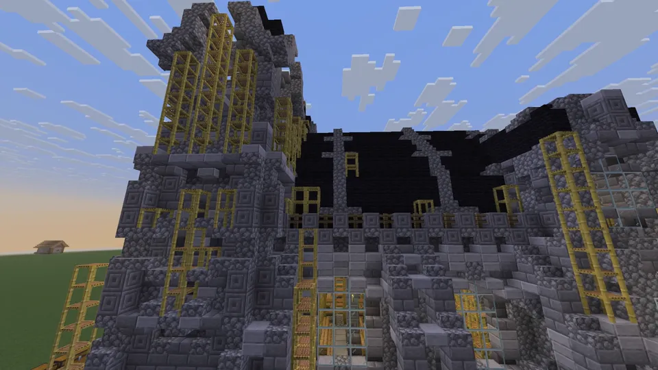
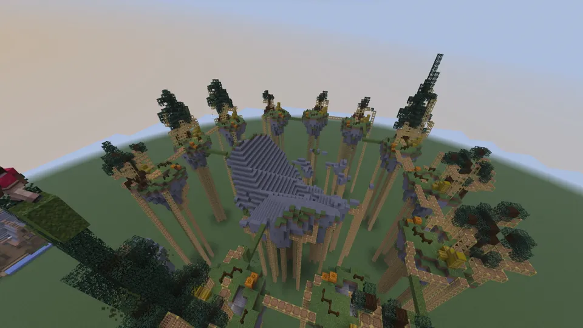

# MCB Builder

**A Minecraft 26.2 bot that builds schematics the way a patient survival player would.** Hand it a schematic and it
builds it from empty ground to a finished, cleaned-up build, unattended. It walks, jumps, climbs and sneaks, never
flies or airplaces, and acts only through keys and mouse clicks.

[**Download**](https://github.com/Owlhours/mcb-builder/releases/latest) · [Singleplayer mod](builder/README.md) ·
[Client mod](client/README.md) · [How it works](docs/METHOD.md) · [Before you build on it](docs/BUILDING-ON-IT.md) ·
[History](docs/HISTORY.md) · [Prompts](prompts.md)

Free, open source (MIT) and unofficial: you run it in your own copy of Minecraft: Java Edition.

## What it does

- **Correct block states.** Every click is checked against Minecraft's own placement code first, so stairs, slabs,
  logs, doors and trapdoors come out facing the right way.
- **Its own scaffolding.** Pillars and bridges reach high or overhanging parts, and come down again at the end.
- **Never stuck for long.** It keeps a way back to its supplies, and digs itself out if it gets boxed in.
- **Restocking.** It plans trips to the supply containers for the blocks it needs next.
- **A self-check.** It judges the result against the schematic, section by section.

| | |
|---|---|
|  |  |

**How well it builds.** In testing it completed **963 of 1,000** randomly drawn builds, and **89 %** of builds over
10,000 blocks. That sample left out builds with redstone components and builds with blocks a survival player can't
place; on an unfiltered sample it was 929 / 1,000. These figures come from a simulator that matched the real game
tick for tick on the builds checked in both; [docs/METHOD.md](docs/METHOD.md) says how they were measured.

## Two mods

| | for | what it drives |
|---|---|---|
| [**builder**](builder/README.md) (`mcb-builder`) | singleplayer test worlds | a bot player named Builder, next to supply chests the mod sets up and fills for you |
| [**client**](client/README.md) (`mcb-client`) | your own character | your player, with supplies from containers you register, and safety stops that hand control back to you |

## What you need

- **Your own copy of Minecraft: Java Edition 26.2.** This repository contains no Minecraft code, assets or data.
- **Fabric Loader 0.19.5** or newer, and **Java 25**. The client mod also needs **Fabric API**.
- The jars are on the [releases page](https://github.com/Owlhours/mcb-builder/releases/latest), with a
  `SHA256SUMS` file to check them against (`sha256sum -c SHA256SUMS --ignore-missing`).

**Build it yourself:** run `builder/build.sh` or `client/build.sh` with a JDK 25. Minecraft 26.2 ships unobfuscated,
so the mods compile directly against the vanilla jars; the scripts download those from Mojang (and Fabric Loader,
Mixin and Fabric API from the Fabric Maven) into a local `.deps/` folder, check each against a pinned SHA-1, and
use them only to compile. They are never committed or redistributed. Every push is built by
[GitHub Actions](.github/workflows/ci.yml), which also runs `tools/check-public-tree.sh`: it fails if game files,
schematics or compiled code are anywhere in the repository or its history.

## How it was made

The code was written by Claude agents in an automated loop against a fixed benchmark, over ten days in November 2026,
with a person setting the goals and making the calls. The commit history is the real development history, and the
commits name the agent in a `Co-Authored-By` line. Changes were judged by measurement on held-out builds rather than
read line by line; [docs/BUILDING-ON-IT.md](docs/BUILDING-ON-IT.md) explains what that means for anyone reusing the
code, and [prompts.md](prompts.md) records what the owner asked for along the way.

## Licence

MIT, for this project's original work; see [LICENSE](LICENSE).

NOT AN OFFICIAL MINECRAFT PRODUCT. NOT APPROVED BY OR ASSOCIATED WITH MOJANG OR MICROSOFT. Minecraft is a trademark
of Mojang Synergies AB; its code and assets belong to Mojang and Microsoft under the
[Minecraft EULA](https://www.minecraft.net/en-us/eula).
